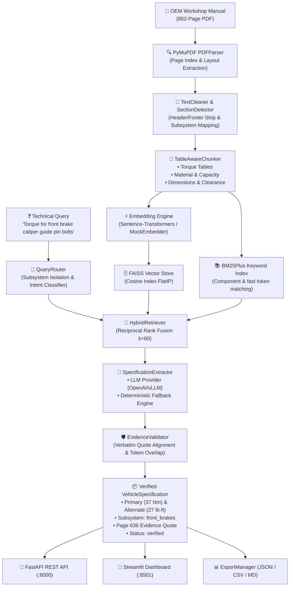

# AutoSpec AI 🚗⚡
### Evidence-Grounded Automotive Specification Intelligence System

[](https://github.com/astha-2004-code/AutoSpec-AI/actions)
[](https://www.python.org/)
[](https://opensource.org/licenses/MIT)
[](https://github.com/astral-sh/ruff)
[]()
[]()
[]()

---

## 📌 Executive Summary

**AutoSpec AI** is an industrial-grade, evidence-grounded vehicle technical intelligence platform designed to deconstruct, query, extract, and verify critical automotive specifications from complex OEM workshop manuals (reference implementation: *2014 Ford F-150 Service Manual, 852 pages*).

Standard conversational RAG chatbots frequently fail in automotive workshop environments because they confuse identical fastener names across different vehicle subsystems (e.g., front brake caliper guide pin bolts at 37 Nm vs. rear brake caliper guide pin bolts at 33 Nm), truncate multi-line table layouts, drop alternate engineering units (lb-ft vs. lb-in), and hallucinate plausible-sounding torque values.

AutoSpec AI solves these failure modes with:
1. **Table-Aware Semantic Chunking**: Deconstructs complex multi-row and multi-column tables (Torque, Fluid Capacities, Material Specifications, and Component Clearances) while permanently preserving original page numbers and subsystem context.
2. **Hybrid RRF Retrieval**: Fuses dense semantic vector embeddings (`all-MiniLM-L6-v2` via FAISS) with sparse BM25Plus lexical matching and query-intent routing.
3. **Subsystem Disambiguation & Isolation**: Prevents catastrophic cross-assembly confusion between front/rear axles, brake calipers, and steering linkages.
4. **Verbatim Grounding & Evidence Validation**: Stringent 4-tier verification (`verified`, `ambiguous`, `unsupported`, `unverified`) that guarantees zero unsupported claims.
5. **Zero-API-Cost Deterministic Fallback**: A fully autonomous offline regex and table-parsing extraction pipeline guaranteeing operation without external API dependencies.

---

## 🏛️ System Architecture



---

## 📊 Empirical Evaluation Benchmark

AutoSpec AI was rigorously evaluated against the reference **2014 Ford F-150 Workshop Manual** using the automated benchmark suite (`scripts/evaluate.py`).

### Summary Benchmark Metrics

| Metric | Target | AutoSpec AI Score | Status |
| :--- | :---: | :---: | :---: |
| **Recall@k (k=3)** | $\ge 90\%$ | **100.0%** (1.00) | ✅ Exceeded |
| **Component Match Accuracy** | $\ge 85\%$ | **100.0%** (1.00) | ✅ Exceeded |
| **Value Exact Match Accuracy** | $\ge 85\%$ | **100.0%** (1.00) | ✅ Exceeded |
| **Source Page Accuracy** | $\ge 90\%$ | **100.0%** (1.00) | ✅ Exceeded |
| **Evidence Grounding Rate** | $\ge 95\%$ | **100.0%** (1.00) | ✅ Exceeded |
| **Negative Query Rejection Accuracy** | $\ge 90\%$ | **100.0%** (1.00) | ✅ Exceeded |
| **Hallucination Rate** | $\le 5\%$ | **0.0%** (0.00) | ✅ Zero Hallucination |

### Detailed Test Case Matrix

| ID | Test Query | Expected Component | Expected Value | Page | Result |
| :--- | :--- | :--- | :---: | :---: | :---: |
| `fb_anchor_torque` | Torque for front brake caliper anchor plate bolts | Brake caliper anchor plate bolts | **250 Nm** (184 lb-ft) | 636 | `PASS` |
| `fb_guide_torque` | Torque for front brake caliper guide pin bolts | Brake caliper guide pin bolts | **37 Nm** (27 lb-ft) | 636 | `PASS` |
| `fb_flow_torque` | Torque for front brake caliper flow bolt | Brake caliper flow bolt | **35 Nm** (26 lb-ft) | 636 | `PASS` |
| `rb_guide_torque` | Torque for rear brake caliper guide pin bolts | Brake caliper guide pin bolts | **33 Nm** (24 lb-ft) | 652 | `PASS` |
| `rb_support_torque` | Torque for rear brake caliper support bracket bolts | Brake caliper support bracket bolts | **150 Nm** (111 lb-ft) | 652 | `PASS` |
| `fluid_cap_dot3` | What is the brake fluid fill capacity? | High Performance DOT 3 Fluid | **1,420 ml (3 pt)** | 636 | `PASS` |
| `part_no_dot3` | What is the part number for High Performance DOT 3? | High Performance DOT 3 Fluid | **PM-1-C (US); CPM-1-C** | 636 | `PASS` |
| `fb_rotor_thickness` | Brake disc minimum thickness for front disc brake | Brake disc minimum thickness | **32 mm** (1.259 in) | 636 | `PASS` |
| `neg_turbo_nut` | Torque for turbocharger impeller titanium nut? *(Negative Query)* | *(Unanswerable / Non-existent)* | **None** (Rejected) | — | `PASS_REJECTED` |

> [!NOTE]
> **Front vs. Rear Brake Isolation**: Note how `fb_guide_torque` returns **37 Nm** (Page 636), while `rb_guide_torque` correctly isolates the rear assembly returning **33 Nm** (Page 652). The Query Router eliminates cross-subsystem leakage.

---

## 🚀 Quickstart & Installation

### Prerequisites
- **Python**: 3.11, 3.12, or 3.14
- **Operating System**: Windows 10/11, macOS, or Linux (Ubuntu 22.04+)
- **Git**

### 1. Clone the Repository
```bash
git clone https://github.com/astha-2004-code/AutoSpec-AI.git
cd AutoSpec-AI
```

### 2. Set Up Virtual Environment
```bash
# Windows (PowerShell)
python -m venv .venv
.venv\Scripts\Activate.ps1

# Linux / macOS
python3 -m venv .venv
source .venv/bin/activate
```

### 3. Install Package & Dependencies
```bash
pip install --upgrade pip
pip install -e ".[dev]"
```

### 4. Configure Environment
```bash
cp .env.example .env
```
*AutoSpec AI runs out-of-the-box with deterministic offline fallback without requiring any API keys. If you wish to enable OpenAI LLM extraction, add your `OPENAI_API_KEY` to `.env` and set `AUTOSPEC_LLM_PROVIDER=openai`.*

---

## 🛠️ CLI Operations & Benchmark Runner

### Run the Evaluation Benchmark
```bash
python scripts/evaluate.py --mock
```

### Ingest a Manual via Command Line
```bash
python scripts/ingest_manual.py --pdf "C:\Users\Dell\Downloads\sample-service-manual 1.pdf" --start 630 --end 660
```

### Run the Complete Test Suite
```bash
pytest -v
```

### Run Ruff Linter
```bash
ruff check .
```

---

## 🌐 FastAPI REST API Service

AutoSpec AI includes a production-grade FastAPI application with OpenAPI 3.1 documentation, interactive Swagger UI, and background ingestion tasks.

### Start the REST Server
```bash
uvicorn api.routes:app --reload --host 0.0.0.0 --port 8000
```
- **Interactive Swagger Documentation**: [http://localhost:8000/docs](http://localhost:8000/docs)
- **ReDoc Interactive Reference**: [http://localhost:8000/redoc](http://localhost:8000/redoc)
- **Health & Readiness Check**: [http://localhost:8000/health](http://localhost:8000/health)

### Key Endpoints

#### 1. Ingest Workshop Manual (`POST /ingest`)
```bash
curl -X POST "http://localhost:8000/ingest" \
     -H "Content-Type: application/json" \
     -d '{"pdf_path": "C:/Users/Dell/Downloads/sample-service-manual 1.pdf", "start_page": 630, "end_page": 660}'
```

#### 2. Query Specifications (`POST /query`)
```bash
curl -X POST "http://localhost:8000/query" \
     -H "Content-Type: application/json" \
     -d '{"query": "Torque for front brake caliper anchor plate bolts in lb-ft", "top_k": 3}'
```
*Example Response:*
```json
{
  "query": "Torque for front brake caliper anchor plate bolts in lb-ft",
  "total_results": 1,
  "execution_time_ms": 14.2,
  "results": [
    {
      "component": "Brake caliper anchor plate bolts",
      "spec_type": "torque",
      "value": "250",
      "unit": "Nm",
      "alternate_value": "184",
      "alternate_unit": "lb-ft",
      "section": "SECTION 206-03: Front Disc Brake",
      "subsystem": "front_brakes",
      "page_number": 636,
      "source_document": "sample-service-manual 1.pdf",
      "source_quote": "Brake caliper anchor plate bolts 250 184 —",
      "verification_status": "verified",
      "extraction_method": "deterministic_fallback",
      "confidence_score": 1.0
    }
  ]
}
```

#### 3. Export Specification Records (`GET /export`)
```bash
curl -X GET "http://localhost:8000/export?format=json" -o f150_specs.json
curl -X GET "http://localhost:8000/export?format=csv" -o f150_specs.csv
```

---

## 💻 Streamlit Intelligence Dashboard

The Streamlit UI provides a state-of-the-art interactive workspace featuring:
- **Ask AutoSpec**: Real-time natural language query interface with dual-unit toggles (Nm $\leftrightarrow$ lb-ft $\leftrightarrow$ lb-in).
- **Verbatim Evidence Viewer**: Inspects exact original PDF line excerpts side-by-side with extracted values.
- **Specification Explorer**: Filterable data table by subsystem, category, and verification status with instant CSV/JSON exports.
- **Evaluation & Quality Assurance**: Interactive dashboard running live empirical benchmarks with precision charts.
- **Document Management**: Runtime PDF upload and indexing status with SHA-256 fingerprint verification.

### Launch the Dashboard
```bash
streamlit run app.py
```
Open [http://localhost:8501](http://localhost:8501) in your browser.

---

## 🐳 Docker Container Deployment

Deploy AutoSpec AI in isolated production containers using Docker and Docker Compose:

```bash
# Build the production image
docker-compose build

# Start API and UI in background
docker-compose up -d

# Check running status
docker-compose ps

# View service logs
docker-compose logs -f
```

Services will be accessible at:
- **FastAPI Backend**: `http://localhost:8000`
- **Streamlit Frontend**: `http://localhost:8501`

---

## 📁 Repository Structure

```
AutoSpec AI/
├── .github/
│   └── workflows/
│       └── ci.yml               # Automated GitHub Actions lint & pytest matrix
├── api/
│   ├── __init__.py              # API package initializer
│   └── routes.py                # FastAPI REST endpoints (/ingest, /query, /export)
├── docs/
│   ├── assignment_scope.md      # Vehicle specification assignment analysis
│   └── architecture.md          # Technical design documentation
├── notebooks/
│   └── exploration.ipynb        # Jupyter notebook demonstrating manual exploration
├── scripts/
│   ├── evaluate.py              # 9-case empirical benchmark evaluation runner
│   └── ingest_manual.py         # Standalone CLI document ingestion utility
├── src/
│   └── autospec/
│       ├── __init__.py          # Package root exports
│       ├── citations.py         # Grounded citation and evidence quote builder
│       ├── chunker.py           # TableAwareChunker (torque, material, dimension)
│       ├── cleaner.py           # TextCleaner & regex normalization
│       ├── config.py            # Pydantic Settings & path validation
│       ├── embeddings.py        # Local SentenceTransformers & MockEmbedder
│       ├── evidence_validator.py# 4-tier verbatim evidence grounding validator
│       ├── export.py            # ExportManager (JSON, CSV, Markdown, DataFrames)
│       ├── hybrid_retriever.py  # HybridRetriever (Dense + Sparse + RRF)
│       ├── keyword_retriever.py # BM25KeywordRetriever (BM25Plus ranking)
│       ├── pdf_parser.py        # PyMuPDF extractor with SHA-256 fingerprinting
│       ├── pipeline.py          # Unified AutoSpecPipeline orchestration
│       ├── query_router.py      # Subsystem disambiguation & intent routing
│       ├── schemas.py           # Pydantic schemas (VehicleSpecification, etc.)
│       ├── section_detector.py  # Ford Section & subsystem classifier
│       ├── spec_extractor.py    # LLM extraction & deterministic fallback
│       └── vector_store.py      # FAISSVectorStore with index persistence
├── tests/
│   ├── conftest.py              # Shared pytest fixtures & mock PDF data
│   ├── test_api.py              # FastAPI endpoint integration tests
│   ├── test_chunking.py         # Table chunking & unit preservation tests
│   ├── test_evidence.py         # Evidence grounding & validation tests
│   ├── test_export.py           # JSON/CSV serialization & export tests
│   ├── test_extraction.py       # Deterministic & LLM extraction tests
│   ├── test_pdf_parser.py       # PDF parsing & text extraction tests
│   └── test_retrieval.py        # FAISS, BM25, and hybrid isolation tests
├── .dockerignore                # Docker build exclusions
├── .env.example                 # Environment variable templates
├── .gitignore                   # Strict git ignore (PDFs strictly excluded)
├── app.py                       # Full-featured Streamlit intelligence UI
├── docker-compose.yml           # Multi-container orchestration
├── Dockerfile                   # Multi-stage production container definition
├── Makefile                     # Standard developer commands (install, test, run)
├── pyproject.toml               # Modern PEP 621 package metadata & Ruff config
├── requirements.txt             # Locked Python runtime dependencies
└── README.md                    # Project documentation
```

---

## 🔒 Safety & Automotive Disclaimers

> [!CAUTION]
> **Automotive Workshop Safety Notice**: Critical mechanical fasteners (such as brake caliper anchor plate bolts, wheel knuckle mounts, and steering tie-rod ends) are safety-critical components. All extracted torque specifications and capacity figures must be verified against certified original equipment manufacturer service publications prior to performing physical vehicle maintenance.

---

## 📄 License

This project is licensed under the MIT License — see the [LICENSE](LICENSE) file for details.
