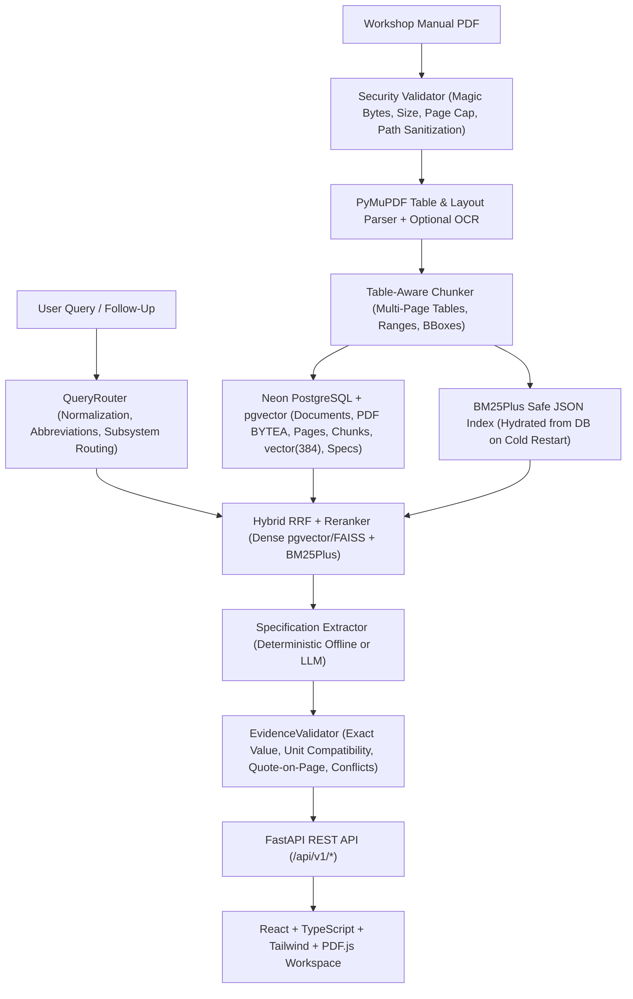

# AutoSpec AI 2.0

**Engineering Specifications. Verified at the Source.**

AutoSpec AI is a full-stack, evidence-grounded automotive specification intelligence platform built for workshop engineers and technical teams to extract, verify, compare, and visually cite OEM specification data from PDF service manuals.

---

## Why AutoSpec AI?

Generic document RAG chatbots fail on workshop manuals because automotive PDFs pack critical torque specs, clearances, tolerances, and fluid capacities into multi-column tables and split subsystems across sections. Common failure modes include:

- **Component conflation**: Confusing front vs. rear brake caliper guide pins or drain vs. fill plugs.
- **Lost alternate units**: Dropping `lb-ft` / `in-lb` / `qt` equivalents when wrapping table lines.
- **Unverified fabrication**: Returning plausible numbers with partial digit matches or mismatched units.
- **Lack of visual auditability**: No page coordinates or original PDF inspection to trust safety-critical values.

AutoSpec AI addresses each gap with table-aware chunking, hybrid retrieval (`pgvector` / FAISS + automotive-tokenized BM25Plus + RRF + reranking), a deterministic zero-hallucination `EvidenceValidator`, normalized PostgreSQL persistence, and an interactive React + PDF.js workspace.

---

## Architecture Overview



---

## Technology Stack

- **Frontend**: React 19, TypeScript, Vite, Tailwind CSS, Lucide Icons, TanStack Query, Recharts, `pdfjs-dist` (PDF.js)
- **Backend**: Python 3.11+, FastAPI, Pydantic v2, PyMuPDF (`fitz`)
- **Database & Vector Search**: Neon PostgreSQL + `pgvector` (`vector(384)`, HNSW cosine index), SQLAlchemy 2, Alembic migrations (with automatic SQLite fallback for local tests)
- **Retrieval & Verification**: Sentence Transformers (`all-MiniLM-L6-v2`) / mock embedder, `rank_bm25` (`BM25Plus`), Reciprocal Rank Fusion, CPU feature reranking, deterministic offline extraction mode
- **Deployment & CI/CD**: Render (Docker), Vercel (`frontend/vercel.json`), GitHub Actions (`.github/workflows/ci.yml`)

---

## Database Schema (Neon PostgreSQL + `pgvector`)

Managed via Alembic (`migrations/versions/0001_initial_pgvector_schema.py`):

- `sessions` — Browser session isolation (`X-Session-ID`)
- `vehicles` — Normalized vehicle manufacturer, model, year, variant
- `documents` — Document metadata, SHA-256 fingerprint deduplication, demo flags, and `pdf_data` BYTEA storage for restart persistence
- `document_pages` — Extracted per-page text and OCR flags for strict quote grounding
- `document_chunks` — Section, subsystem, table-aware content, and serialized bounding boxes
- `chunk_embeddings` — `vector(384)` column with HNSW `vector_cosine_ops` index on PostgreSQL
- `specifications` & `citations` — Verified specification rows linked back to page & quote coordinates
- `ingestion_jobs` — Background stage progress (`uploading -> parsing -> chunking -> embedding -> indexing -> validating -> completed`), duplicate linking, cancel & retry tracking
- `search_history` & `conversation_contexts` — Session-scoped search history and follow-up state
- `evaluation_runs` & `evaluation_results` — Persisted benchmark metrics

---

## Core Workspace Capabilities

- **Landing Showcase (`/`):** Zero-login interactive demo, system architecture summary, and live backend metrics.
- **Overview (`/overview`):** Real-time DB counts for indexed manuals, pages, chunks, verified specs, subsystem coverage, and recent queries.
- **Ask AutoSpec (`/workspace`):** Three-panel split workspace (manual & subsystem filters, conversational specification search with retrieval score vs. verification status, interactive PDF.js evidence inspector).
- **Document Library (`/documents`):** Drag-and-drop PDF upload, SHA-256 duplicate linking, 7-stage progress bar, cancellation, retry on failure, metadata editing, re-indexing, deletion, and inline PDF preview modal.
- **Specification Explorer (`/explorer`):** Filter all extracted specs across vehicles by subsystem, spec type, and verification status, plus CSV/JSON export.
- **Vehicle Comparison (`/compare`):** Side-by-side platform matrix with SI/Imperial normalization (`Nm` <-> `lb-ft`, `L` <-> `qt`, `mm` <-> `in`), source page links, and variance flags.
- **Search History (`/history`):** Session audit trail with one-click query replay and deletion.
- **Evaluation (`/analytics`):** Honest, reproducible 362-case benchmark & 4-mode ablation metrics (`bm25`, `dense`, `hybrid`, `hybrid_rerank`).
- **Settings (`/settings`):** Live health diagnostics (`database_backend`, `pgvector_enabled`, active embedder/provider), local unit/retrieval preferences, and session rotation.

---

## Measured Evaluation Results

Run reproducibly via `python scripts/evaluate.py --mock` on the 362-case source-verified benchmark (`data/benchmarks/autospec_benchmark_v2.json`: 158 tuning cases across `Apex M400` & `Apex S250`, 204 held-out cases across unseen `Apex R180` + rotated/adversarial variants, report at `data/benchmarks/latest_benchmark.json`):

| Retrieval Mode (Held-Out, 204 cases, `--mock` embedder) | Recall@5 | MRR | Exact Value Acc. | Citation Acc. | Negative Rejection | P50 Latency |
| --- | --- | --- | --- | --- | --- | --- |
| `bm25` (BM25Plus) | 94.33% | 0.9433 | 94.33% | 94.33% | 90.00% | 9.82 ms |
| `dense` (Mock Hash Vector) | 47.42% | 0.2802 | 22.16% | 50.52% | 100.00% | 3.53 ms |
| `hybrid` (RRF Fusion) | 85.57% | 0.7903 | 79.38% | 88.14% | 100.00% | 7.01 ms |
| `hybrid_rerank` (RRF + Reranker) | 89.69% | 0.8802 | 88.14% | 90.72% | 100.00% | 6.80 ms |

> Note: The CI benchmark executes with `DeterministicMockEmbedder(384)` for offline reproducibility, which explains why hash-based `dense` alone underperforms `bm25` while second-stage reranking (`hybrid_rerank`) restores exact match accuracy and achieves `100%` negative rejection on unanswerable held-out queries. Production deployments use `all-MiniLM-L6-v2` semantic embeddings with `pgvector`.

---

## Local Development Quickstart

### Backend

```bash
python -m venv .venv
source .venv/bin/activate   # Windows: .venv\Scripts\activate
pip install -e ".[dev]"
alembic upgrade head
uvicorn api.routes:app --reload --host 127.0.0.1 --port 8000
```

### Frontend

```bash
cd frontend
npm install
cp .env.example .env.local
npm run dev
```

Open `http://localhost:5173`. API interactive docs are available at `http://localhost:8000/docs`.

---

## Testing & Verification

```bash
# Backend linter, migrations & pytest (CI mode)
ruff check .
AUTOSPEC_EMBEDDING_MODEL=mock pytest -v

# Frontend formatting, ESLint, TypeScript, Vitest & production bundle
cd frontend
npm run format:check
npm run lint
npx tsc -b --noEmit
npm test
npm run build
```

For Neon + Render + Vercel production setup instructions, see [`docs/deployment.md`](docs/deployment.md).
