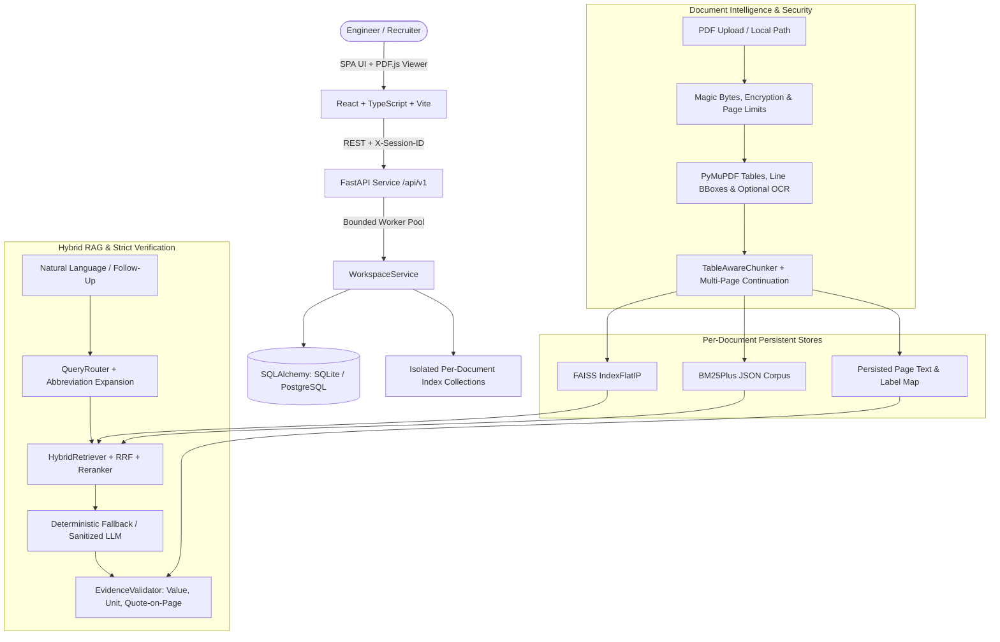

# AutoSpec AI v2.0 — System Architecture

## 1. High-Level System Architecture

## 2. Core Design Decisions & Trade-Offs

- **Isolated Per-Document Collections (`WorkspaceService`)**: Replaces the legacy shared singleton pipeline with per-document FAISS/BM25/page stores and a SQLAlchemy metadata repository (`documents`, `ingestion_jobs`, `search_history`, `conversation_contexts`), preventing cross-user data leakage and concurrent write corruption.
- **Safe JSON BM25 Persistence**: Eliminates `pickle` deserialization risks by storing tokenized corpora as JSON and reconstructing `BM25Plus` in memory on load.
- **Strict Grounding & Unit Normalization (`units.py`, `evidence_validator.py`)**: Prevents partial-digit matches (`"3"` matching `"37"`), verifies physical unit compatibility, persists page text alongside indexes so cached loads retain full page verification, and exposes six explicit statuses (`verified`, `partially_supported`, `conflicting_evidence`, `ambiguous`, `insufficient_evidence`, `not_found`).
- **Deterministic Offline + CPU Reranking**: Ensures zero-API-key operation and fast local inference, with optional `CrossEncoder` weights and LLM providers configurable via environment variables.
- **PDF.js Evidence Grounding**: Persists real PyMuPDF line/row bounding boxes and both physical page numbers and printed manual page labels so citations open directly to the source page with coordinate overlays.
