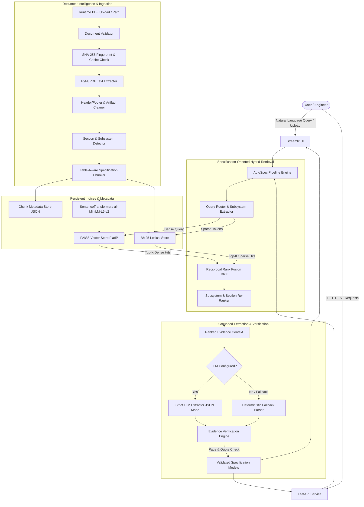

# AutoSpec AI — System Architecture

## 1. High-Level System Architecture

---

## 2. Core Architectural Components

### 2.1 Ingestion & Document Intelligence
- **Document Validator**: Checks file existence, MIME type, `%PDF` magic bytes, file size limits (`MAX_UPLOAD_SIZE_MB`), and prevents directory traversal attacks.
- **Fingerprinting**: Computes SHA-256 hash of the PDF binary to support incremental index caching. If a document has already been processed, the index is loaded directly from disk in under 200ms.
- **PyMuPDF Parser**: Extracts text page-by-page, retaining 1-indexed page numbers and block-level geometry.
- **Cleaner**: Removes running footers (`Page X sur Y`, local file URLs, revision timestamps) while safeguarding decimal values, dashes, part numbers, and units.
- **Section Detector**: Identifies workshop manual sections (`SECTION 206-03: Front Disc Brake`), subsections, and specification blocks.

### 2.2 Table-Aware Specification Chunker
- Preserves the semantic association between:
  - Table category (`Torque Specifications`, `General Specifications`, `Material / Capacities`).
  - Column headers (`Description`, `Nm`, `lb-ft`, `lb-in`, `Specification`, `Fill Capacity`).
  - Row components and fasteners.
  - Primary and secondary numerical values with their associated units.
- Generates self-contained semantic text chunks enriched with structured metadata (`section_id`, `section_title`, `subsystem`, `page_number`, `table_type`).

### 2.3 Hybrid Retrieval Engine
- **Dense Vector Search**: Uses `sentence-transformers/all-MiniLM-L6-v2` (384 dimensions) and FAISS `IndexFlatIP` with normalized vectors for cosine similarity.
- **Sparse Lexical Search**: BM25Okapi tuned with custom tokenization that preserves automotive alphanumeric tokens (e.g., `PM-1-C`, `WSS-M6C62-A`, `250`, `Nm`).
- **Query Router**: Analyzes user queries to identify target subsystems (`front disc brake` vs `rear disc brake`), component targets (`caliper anchor plate`, `guide pin`), and specification types (`torque`, `capacity`, `dimension`).
- **Reciprocal Rank Fusion (RRF)**:
  $$\text{RRF Score}(d) = \frac{w_{\text{semantic}}}{k + r_{\text{semantic}}(d)} + \frac{w_{\text{lexical}}}{k + r_{\text{lexical}}(d)}$$
  Where $k = 60$ by default, providing balanced ranking without arbitrary score scaling.

### 2.4 Evidence-Grounded Extraction & Deterministic Fallback
- **Strict Schema**: Pydantic models enforcing typing for `component`, `spec_type`, `value`, `unit`, `alternate_value`, `alternate_unit`, `range_min`, `range_max`, `part_number`, `material`, `section`, `page_number`, `source_quote`, and `verification_status`.
- **LLM Mode**: Uses structured JSON output with a prompt strictly forbidding ungrounded values.
- **Deterministic Fallback Engine**: High-precision regular expressions and table row parsing capable of extracting torque, capacity, clearances, and part numbers without external API dependencies.
- **Evidence Validator**:
  - Verifies that `source_quote` is an exact substring of the extracted source page text.
  - Verifies that `value` and `unit` exist inside `source_quote`.
  - Flags cross-subsystem mismatches (e.g., query for rear brakes matching front brake section).
  - Assigns status: `VERIFIED`, `AMBIGUOUS`, or `UNSUPPORTED`.

---

## 3. Technology Stack Rationale

| Layer | Selected Tool | Rationale |
|---|---|---|
| PDF Extraction | PyMuPDF (`fitz`) | 10x faster than pdfminer, preserves layout text blocks and page numbers accurately |
| Embeddings | `sentence-transformers/all-MiniLM-L6-v2` | Lightweight (80MB), fast CPU inference, strong retrieval performance |
| Vector Index | FAISS (`faiss-cpu`) | Industry standard vector search with sub-millisecond retrieval on local CPU |
| Lexical Search | `rank-bm25` | Exact match precision for part numbers, alphanumeric codes, and units |
| Ranking | Reciprocal Rank Fusion | Proven hybrid merger that does not require score normalization calibration |
| Validation | Pydantic v2 | Robust type safety, validation hooks, serialization |
| API | FastAPI | Asynchronous REST service with automatic OpenAPI documentation and input validation |
| UI | Streamlit | Rapid, responsive web dashboard with rich data display and interactive filtering |
| Tabular Export | Pandas | Robust CSV and JSON export pipelines |
